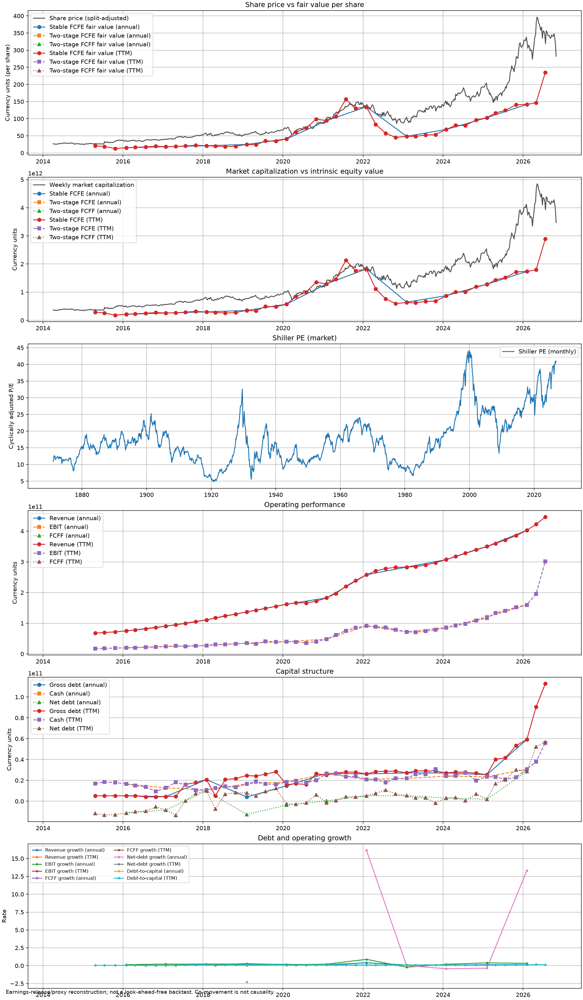

# Wavebird


Comparative DCF analysis tool. Uses AlphaVantage API. DCF analysis formulas from [Aswath Damodaran's website](https://pages.stern.nyu.edu/~adamodar/) and The Little Book of Valuation. AlphaVantage limits to 25 API calls a day on free tier. Calls are cached in SQLite db. 



Check out the example PDF in this repo.

## Requirements

- Python 3.12, 3.13, or 3.14
- [uv](https://docs.astral.sh/uv/)

```bash
uv sync --group dev
```

## API key

```bash
export ALPHAVANTAGE_API_KEY=...
```

Free keys: <https://www.alphavantage.co/support/#api-key>.   
Alternatively, put the key in a `.env` file next to `pyproject.toml`:

```dotenv
ALPHAVANTAGE_API_KEY=...
```

The free tier allows 25
requests per day. A completely cold single-symbol analysis makes exactly six Alpha
requests: income statement, cash flow, balance sheet, earnings, company weekly prices,
and shared SPY weekly prices. All responses are cached in SQLite, so subsequent runs are
free. 

## Interactive mode

```bash
uv run wavebird # --edit-assumptions to change variables
```

## Models and tradeoffs

- **Stable FCFE** — `V = EPS × (1+g) × (1 − g/ROE) / (k_e − g)`. A steady-state sanity
  check for mature firms; compact but highly sensitive to stable growth and ROE, and it
  cannot represent a transition period.
- **Two-stage FCFE** — projects per-share FCFE through the explicit stage (EPS, CapEx,
  depreciation, revenue, and working capital each grown at their configured rates,
  reinvestment weighted by the target debt ratio), then a Gordon-growth terminal value at
  the stable-stage cost of equity. It models the transition but is sensitive to all four
  projection assumptions.
- **Two-stage FCFF** — projects NOPAT-based free cash flow to the firm, discounts at
  WACC, deducts debt and option overlays, and divides by shares. It is the
  operating/capital-structure cross-check and is preferable when borrowing distorts
  equity cash flow; it adds WACC, target-debt, tax, cash/debt, and option-value
  assumptions.

## Assumptions file

All rates are decimal fractions. Copy `examples/assumptions.toml` and edit it; those
values are examples, not recommendations — supply your own thesis.

| Field | Meaning | Example |
| --- | --- | --- |
| `forecast_years` | Explicit projection years | `5` |
| `high_growth_rate` | Growth during the explicit stage | `0.06` |
| `stable_growth_rate` | Perpetuity growth; must be below stable ROE/ROC and discount rates | `0.025` |
| `stable_roe` | Steady-state return on equity | `0.12` |
| `stable_roc` | Steady-state return on capital | `0.10` |
| `stable_beta` | Beta used for the stable-stage discount rate | `1.0` |
| `pretax_cost_of_debt` | Pre-tax borrowing cost | `0.05` |
| `target_debt_weight` | Target debt weight in capital | `0.20` |
| `margin_of_safety` | Required discount to value for the screen | `0.25` |
| `capex_growth_rate` | Optional; defaults to `high_growth_rate` | `0.06` |
| `depreciation_growth_rate` | Optional; defaults to `high_growth_rate` | `0.06` |
| `revenue_growth_rate` | Optional; defaults to `high_growth_rate` | `0.06` |
| `equity_option_value` | Option/warrant overlay deducted in FCFF | `0` |

Discount rates use the contemporaneous Damodaran risk-free rate and implied equity risk
premium; the high stage uses the measured beta, the stable stage uses `stable_beta`.
The effective tax rate is the median of up to three recent positive
`tax expense / pre-tax income` observations and its source periods are disclosed.

## Cache

Responses live in a versioned SQLite database (default
`$XDG_CACHE_HOME/wavebird/cache.sqlite3`, override with `WAVEBIRD_CACHE_PATH`).
Statements and earnings are kept for 7 days, weekly prices for 1 day, the Damodaran
annual workbook and the multpl Shiller PE table for 30 days, and the Damodaran monthly
workbook for 7 days. `--refresh` and the `cache refresh` / `rates refresh` commands force
downloads. If a download fails or the quota is exhausted, an expired row may still be used
and is explicitly labeled `STALE` in the report. API keys are never written to the cache.

## Data sources

- Alpha Vantage API: <https://www.alphavantage.co/documentation/>
- Damodaran annual implied ERP: <https://pages.stern.nyu.edu/~adamodar/pc/datasets/histimpl.xls>
- Damodaran monthly ERP: <https://pages.stern.nyu.edu/~adamodar/pc/implprem/ERPbymonth.xlsx>
- Shiller PE monthly history: <https://www.multpl.com/shiller-pe/table/by-month>

Wavebird gratefully acknowledges Aswath Damodaran's publicly published datasets.

Three keyless (no-quota) sources supplement Alpha Vantage:

- **SEC ticker directory**
  (<https://www.sec.gov/files/company_tickers.json>) — the full US-listed universe for
  ticker autocomplete, cached 30 days. Requires an identifying User-Agent per SEC
  fair-access policy.
- **multpl Shiller PE table**
  (<https://www.multpl.com/shiller-pe/table/by-month>) — monthly cyclically adjusted P/E
  back to 1871 for the market-context panel, cached 30 days, plotted on its own axis.

## Verification

```bash
uv lock --check
uv run ruff format --check .
uv run ruff check .
uv run ty check
uv run pytest
```

Not investment advice.
